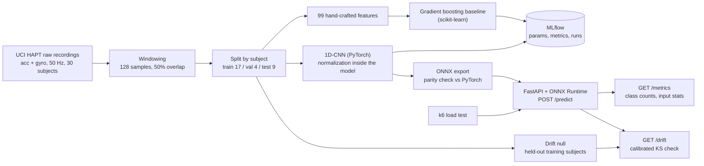
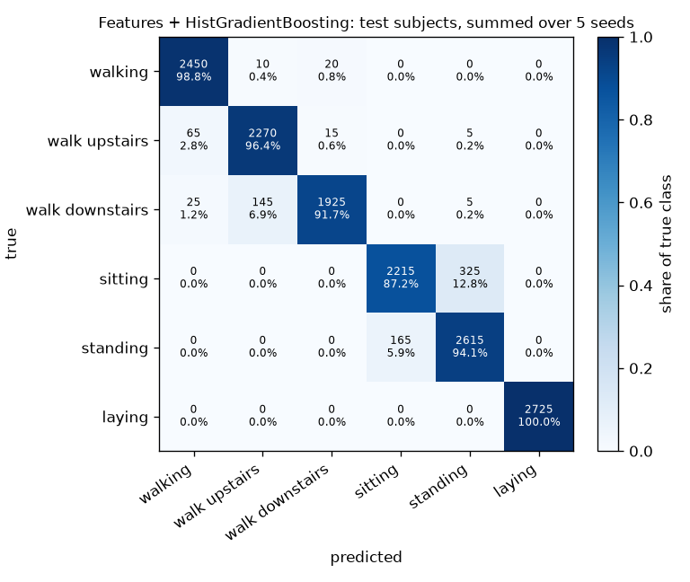

# movement-classifier

[](https://github.com/byteKumar/movement-classifier/actions/workflows/ci.yml)

Classifies human movement from raw smartphone accelerometer and gyroscope signals and serves the model as a monitored API with a drift check.

## Results at a glance

- **Accuracy on people never seen in training:** macro-F1 0.9324 ± 0.0207 for the 1D-CNN and 0.9479 ± 0.0000 for the gradient boosting baseline (9 test subjects, 5 seeds). The CNN does not beat the baseline.
- **Exported model:** ONNX matches PyTorch to a max logit difference of 2.384e-06. The model has 32,550 parameters and is 0.152 MB.
- **Serving on one uvicorn worker (Apple M3):** p50 0.449 ms and p99 0.714 ms for one window, and 500 req/s at p99 < 50 ms.
- **Drift check:** caught 6 of 6 synthetic sensor faults with 0 of 200 false alarms on clean test batches. The first version raised 47 of 200 false alarms.

Full numbers, devices and caveats: [RESULTS.md](RESULTS.md).

## Architecture



| module | what it does |
|---|---|
| `movement/data.py` | reads the raw recordings, cuts 128-sample windows inside each labeled segment, splits by subject |
| `movement/features.py` | 99 features per window for the baseline (statistics, FFT bands, axis correlations) |
| `movement/baseline.py` | `HistGradientBoostingClassifier`, with the number of rounds chosen on validation subjects |
| `movement/cnn.py` | 3-block 1D-CNN, augmentation (3D rotation and gain), training with early stopping |
| `movement/metrics.py`, `evaluation.py` | the shared scoring for both models, plus confusion matrices |
| `movement/tracking.py` | MLflow setup and the machine info recorded with every run |
| `movement/export.py` | ONNX export and the ONNX Runtime vs PyTorch parity check |
| `movement/serve.py` | FastAPI app: `/predict`, `/health`, `/metrics`, `/drift` |
| `movement/monitoring.py` | running input statistics, class counts, recent windows for the drift check |
| `movement/drift.py` | KS drift checks: the first p-value version and the calibrated version used in serving |
| `scripts/` | download, prepare, train, select, evaluate, export, drift evaluation |
| `bench/` | k6 load script, payload builder, benchmark runner, raw results |

## Approach

### Design decisions

| decision | why | trade-off |
|---|---|---|
| Split by subject: the dataset's own 9 test subjects, 4 validation subjects, 17 training subjects | Windows overlap by 50%, and one person's movements look alike, so a random window split leaks. Tests check that no subject, recording or overlapping window is shared, and a mutation check shows the overlap test fails on a leaky split. | Only 17 subjects to train on and 4 for early stopping. Validation F1 moved between 0.91 and 0.96 from one epoch to the next. |
| Decisions made without the test set, with the rule committed before the run | Augmentation was adopted by cross-validation over the 21 non-test subjects (rule in `9fe5e74`). The drift fix was adopted on validation subjects before its test stage could run (rule in `8f78d6a`). | More runs. The idea for augmentation came from a test error (subject 10), so the CNN's test score is slightly test-informed. |
| Normalization stored inside the model | The training set's per-channel mean and std are buffers in the network and part of the ONNX graph, so clients send raw sensor values and there is no separate preprocessing step to drift out of sync. | Retraining on new data changes the model file even if only the statistics change. |
| Drift threshold calibrated on a null of new people | A KS p-value against 5,928 reference windows flags any new person as drift. The calibrated check compares each batch's KS distances to 5,000 clean batches from training subjects held out of the reference. | It ignores differences between people, so it may miss a small real fault. The smallest fault it detects was not measured. |

Other choices:

- **Input format:** the API parses JSON with `json` + NumPy instead of nested pydantic models, because a batch of 32 is 24,576 numbers.
- **Threading:** ONNX Runtime runs with 1 thread per call in FastAPI's thread pool, so concurrent requests can use several cores.

### Data

- **Signals:** 6 raw, unfiltered channels at 50 Hz: accelerometer x/y/z (g) and gyroscope x/y/z (rad/s).
- **Windows:** each labeled activity segment is cut into 128-sample windows (2.56 s) with 50% overlap. A window never crosses a label boundary, and postural transitions are dropped.
- **Classes:** walking, walking upstairs, walking downstairs, sitting, standing, lying.

| split | subjects | windows |
|---|---|---|
| train | 17 | 5,928 |
| val | 4 | 1,487 |
| test | 9 | 2,996 |
| total | 30 | 10,411 |

### Models

- **Baseline:** 99 features per window. For each of 8 channels (the 6 axes plus accelerometer and gyroscope magnitude): mean, std, min, max, energy, dominant frequency and power in 6 FFT bands. Plus the 3 accelerometer axis correlations. `HistGradientBoostingClassifier` uses 86 boosting rounds, chosen on the validation subjects.
- **CNN:** 3-block 1D-CNN with 32,550 parameters on the raw windows. Trained with Adam, batch 64, up to 60 epochs, and early stopping on validation macro-F1 with patience 10, keeping the best-epoch weights. Augmentation is a random 3D rotation of up to 30° plus ±10% gain per channel.

### Evaluation method

- **Fixed split:** 5 seeds (0–4), reported as mean ± sample std over seeds. The test subjects are scored only after all choices are made.
- **Cross-validation:** leave-subjects-out over all 30 subjects, 5 folds of 6 subjects, 5 seeds per fold for the CNN. Reported as mean ± std over the 5 fold means.
- **Served model:** the seed-0 CNN, chosen in `scripts/evaluate.py` before the run, not the best seed.
- **Load test:** k6 v2.4.0, with the plan in `bench/run_bench.sh` written before the first run.
  - 1 uvicorn worker on 127.0.0.1, and k6 on the same machine.
  - 60 s latency runs with one client sending back to back, using single-window and 32-window bodies made of real test-subject windows.
  - A rate ladder of single-window requests from 250 to 4,000 req/s, 60 s per step. A step passes if p99 < 50 ms with no failed requests and no dropped iterations, and the ladder stops at the first failure.
- **Machine:** Apple M3, 16 GB RAM, Python 3.12.10, PyTorch 2.15.0.
- **Devices:** the CNN trained on MPS. The baseline and ONNX Runtime ran on CPU.
- **Tracking:** every training and evaluation run is logged to MLflow.

## Results

### Classification (test subjects, seeds 0–4)

| model | macro-F1 | accuracy | per-seed macro-F1 |
|---|---|---|---|
| Features + gradient boosting | **0.9479 ± 0.0000** | 0.9479 ± 0.0000 | identical for every seed (no randomness without subsampling) |
| 1D-CNN | 0.9324 ± 0.0207 | 0.9308 ± 0.0205 | 0.9229, 0.9095, 0.9217, 0.9482, 0.9594 |

**Leave-subjects-out CV:** CNN 0.9353 ± 0.0268, baseline 0.9391 ± 0.0295. Per-fold macro-F1 (CNN / baseline): 0.908 / 0.926, 0.938 / 0.949, 0.958 / 0.937, 0.965 / 0.982, 0.908 / 0.902.

The baseline leads by 0.004 in CV, well inside the fold-to-fold spread. The two models fail differently:

| per-class F1 (test, mean over seeds) | walking | upstairs | downstairs | sitting | standing | laying |
|---|---|---|---|---|---|---|
| gradient boosting | 0.976 | 0.950 | 0.948 | 0.900 | 0.913 | 1.000 |
| 1D-CNN | 0.982 | 0.976 | 0.987 | **0.798** | 0.851 | 0.999 |

**Hardest pair: sitting vs standing**, for both models.

| | sitting predicted as standing | standing predicted as sitting |
|---|---|---|
| CNN (5 seeds) | 27.4% (696 of 2,540) | 7.1% (197 of 2,780) |
| gradient boosting | 12.8% (65 windows, one model) | 5.9% (33 windows) |

| 1D-CNN | gradient boosting |
|---|---|
|  |  |

**Augmentation choice** (cross-validation over the 21 non-test subjects, 5 folds, 3 seeds per config, MPS):

| config | held-out macro-F1 (15 runs) | per-fold means |
|---|---|---|
| gradient boosting (reference) | 0.9200 ± 0.0350 | 0.924, 0.944, 0.962, 0.888, 0.881 |
| CNN, no augmentation | 0.9155 ± 0.0368 | 0.937, 0.920, 0.964, 0.876, 0.881 |
| **CNN, rotation ≤ 30° + ±10% gain** | **0.9308 ± 0.0387** | 0.937, 0.965, 0.971, 0.883, 0.899 |

- **Decision:** augmentation beat no augmentation on 4 of 5 folds (+0.0154 mean), which met the rule.
- **Without augmentation:** the first CNN run (seed 0, MPS, best epoch 5 of 15) had validation macro-F1 0.9640 but test macro-F1 0.9197 and accuracy 0.9176. It was above the baseline on validation and below it on test. Most of its test errors came from subject 10 (46 of 160 static windows predicted as a walking class), whose phone orientation while lying down differs from most training subjects.
- **Subject 10:** the test subject with the most errors went from 64.1% accuracy (no augmentation, seed 0) to 80.9% (augmented, mean of 5 seeds).

### ONNX export

| check | value |
|---|---|
| max abs logit difference, ONNX Runtime vs PyTorch CPU, 2,996 test windows | 2.384e-06 |
| max abs probability difference | 4.768e-07 |
| same predicted class | 100% of windows |
| max abs logit difference vs PyTorch MPS | 2.861e-06 |
| model size | 151,572 bytes (0.152 MB), 32,550 parameters |

Tests also check batch sizes 1, 7, 32 and 300 against a 1e-4 tolerance.

### Serving (Apple M3, k6, 60 s per run, each measured once)

| run | achieved req/s | p50 ms | p99 ms | failed | dropped |
|---|---|---|---|---|---|
| 1 window, one client | 1,928.0 | 0.449 | 0.714 | 0 | 0 |
| 32 windows, one client | 119.4 | 7.079 | 12.604 | 0 | 0 |
| rate 250 req/s | 250.0 | 1.544 | 29.851 | 0 | 0 |
| rate 500 req/s | 500.0 | 0.954 | 5.970 | 0 | 0 |
| rate 1,000 req/s | 998.6 | 0.600 | 45.670 | 0 | 83 |

- **Highest passing rate: 500 req/s.**
- **1,000 req/s failed** on 83 dropped iterations, even though p99 was under 50 ms.
- **Batch of 32:** costs about 16 times a single window, for a 528 KB JSON body.

### Drift check (200 batches of 256 windows each)

The first version tested each of the 12 features with a KS p-value at alpha 0.01, with a Bonferroni correction. The calibrated version is described below the table.

| data | KS p-value check (first version) | calibrated check (served) |
|---|---|---|
| clean, validation subjects | 200 alarms | 0 |
| clean, test subjects | 47 alarms | **0** |
| each of 6 shifts (noise 0.1× and 0.5× std, acc gain ×1.1 and ×1.5, acc_z or gyro_y reading 0) | 200 | **200** |

- **What a batch is checked on:** each window is summarized by the mean and std of each channel (12 numbers), because the samples inside a window are correlated and KS assumes independent draws.
- **Null distribution:** 200 times, 4 of the 17 training subjects are held out, and 25 batches are drawn from them against a reference of the other 13.
- **Alarm rule:** the smallest per-feature empirical p-value is at or below the null's 1% quantile (8.0e-4). The check fires on 0.92% of its own null batches.
- **Same batches as the first version:** the first check's 47 of 200 reproduced exactly, so both checks saw identical batches.

### Monitoring

- **`GET /metrics`:** request and window counts, how many windows were predicted as each class, and the running per-channel count, mean, std, min and max of all inputs (Welford merge, no samples stored).
- **`GET /drift`:** runs the calibrated check on the last 256 windows.
- **Log:** a JSON summary line every 10,000 windows.

## How to run

```bash
python3.12 -m venv .venv && source .venv/bin/activate
pip install -r requirements.txt && pip install -e .
python scripts/download_data.py   # 79.6 MB zip from the UCI repository, checksum-verified
python scripts/prepare_data.py    # cuts 128-sample windows, caches data/windows.npz
```

Train, evaluate and export:

```bash
python scripts/train_baseline.py
python scripts/select_cnn.py --device mps        # augmentation choice, non-test subjects only
python scripts/evaluate.py --device mps          # 5 seeds + leave-subjects-out CV, saves the served model
python scripts/export_onnx.py                    # artifacts/model.onnx + parity check
python scripts/drift_eval.py                     # first drift check, kept for the record
python scripts/drift_calibrated.py --stage val   # decides on validation subjects
python scripts/drift_calibrated.py --stage test
mlflow ui --backend-store-uri sqlite:///mlflow.db
```

Serve and query:

```bash
uvicorn movement.serve:create_app --factory --port 8000
curl -s localhost:8000/health
curl -s -X POST localhost:8000/predict -H 'content-type: application/json' \
  -d '{"windows": [[[0.9, -0.1, 0.5, 0.0, 0.0, 0.0], ... 128 rows ...]]}'
curl -s localhost:8000/metrics
curl -s localhost:8000/drift
```

`POST /predict` takes 1–256 windows of 128 × 6 raw values (acc in g, gyro in rad/s). For each window it returns a label and the class probabilities, plus a model version (the first 12 hex characters of the ONNX file's SHA-256). Bad shapes, NaN or infinite values, and non-JSON bodies get a 422; more than 256 windows get a 413.

Load test (needs k6, about 10 min, writes `bench/results/`):

```bash
bash bench/run_bench.sh
```

## Tests and CI

```bash
pytest
```

[GitHub Actions](.github/workflows/ci.yml) runs on every push, on ubuntu-latest with Python 3.12 and CPU-only PyTorch:

- pyflakes over the code
- the real HAPT download (checksum-verified, cached), so the data and leakage tests run on the actual recordings
- `pytest -m "not mps and not trained_model"`

Two tests are deselected by marker on CI, and both pass locally:

- `mps` compares the CNN on MPS and CPU, so it needs an Apple GPU.
- `trained_model` runs real test windows through the API with the served model, so it needs trained artifacts that are not in git.

The job fails if any selected test is skipped. Green run: [43928849372](https://github.com/byteKumar/movement-classifier/actions/runs/43928849372), with 67 passed, 0 skipped and 2 deselected.

## Limitations

**Model**
- The CNN does not beat the feature baseline: 0.9324 vs 0.9479 macro-F1 on test, and 0.9353 vs 0.9391 in CV.
- The CNN is much weaker on sitting (F1 0.798).
- The augmentation idea came from a test-set error (subject 10), so the CNN's test score is slightly test-informed. The non-augmented result (0.9197) stays in the record.
- The served model is the seed-0 CNN (test macro-F1 0.9229), fixed in advance. It is below the 5-seed mean, and it is not the best seed.
- Early stopping uses only 4 validation subjects, so it is noisy.

**Serving benchmark**
- Each setting ran once for 60 s, on a laptop with normal desktop load (1-minute load average 2.66–4.12).
- k6 ran on the same machine as the server, so they competed for CPU. Part of the 1,000 req/s failure may come from the load generator, and that step was not rerun.
- p99 under steady load is noisy: 29.851 ms at 250 req/s, but 5.970 ms at 500 req/s.
- Batches are sent as JSON, about 16 times the cost of a single window for 32 windows. A binary format was not tried.

**Drift check**
- Every synthetic shift fired on every batch, so the smallest fault the drift check can detect is unknown.
- Only synthetic shifts were tested, not real sensor faults.

**Tests**
- The MPS test and the trained-model API test do not run on CI.

**Data**
- The dataset (UCI HAPT, Reyes-Ortiz et al.) is licensed for non-commercial use and is not stored in this repo.
