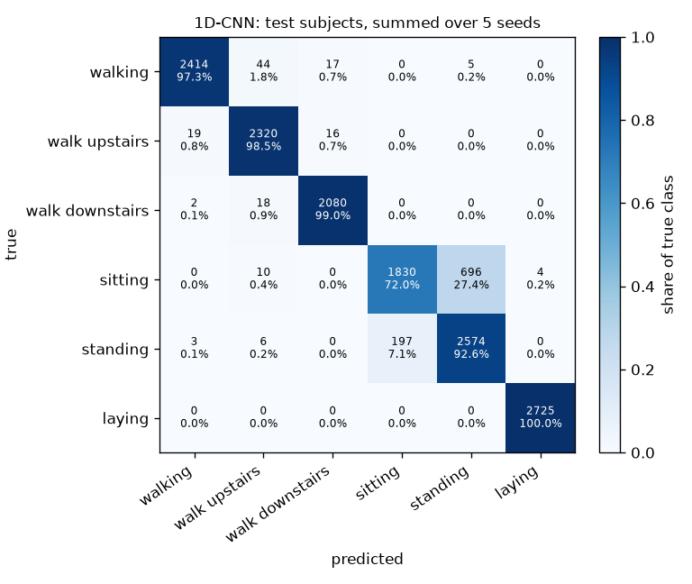

# movement-classifier

[](https://github.com/byteKumar/movement-classifier/actions/workflows/ci.yml)

Classifies human movement (walking, walking upstairs, walking downstairs, sitting, standing, lying) from smartphone accelerometer and gyroscope data at 50 Hz. It covers the whole path from raw sensor streams to a served, monitored model:

- windowing of raw recordings and a train/validation/test split by subject, so no person appears in both training and test
- a hand-crafted-feature baseline with gradient boosting
- a 1D-CNN in PyTorch, with experiment tracking in MLflow
- evaluation over several seeds and leave-subjects-out cross-validation
- ONNX export, served with FastAPI and ONNX Runtime
- drift checks on the input signals, service monitoring, and a k6 load test

Data: the UCI "Smartphone-Based Recognition of Human Activities and Postural Transitions" (HAPT) raw recordings, from the same 30-subject experiment as the UCI HAR dataset. The dataset is downloaded by a script and is not stored in this repo.

## Setup

```bash
python3.12 -m venv .venv && source .venv/bin/activate
pip install -r requirements.txt && pip install -e .
python scripts/download_data.py   # 79.6 MB zip from the UCI repository, checksum-verified
python scripts/prepare_data.py    # cuts 128-sample windows, caches data/windows.npz
pytest
```

## Data pipeline

- 6 channels: accelerometer x/y/z (g) and gyroscope x/y/z (rad/s), raw and unfiltered, 50 Hz.
- Each labeled activity segment is cut into 128-sample windows (2.56 s) with 50% overlap. A window never crosses a label boundary, and postural transitions are dropped.
- Split by subject: the dataset's own 9 test subjects are the test set, 4 of the 21 training subjects are held out for validation, and 17 train. Tests check that no subject, recording or overlapping window is shared across splits.

| split | subjects | windows |
|---|---|---|
| train | 17 | 5,928 |
| val | 4 | 1,487 |
| test | 9 | 2,996 |
| total | 30 | 10,411 |

The dataset (UCI HAPT, Reyes-Ortiz et al.) is licensed for non-commercial use.

## Baseline: features + gradient boosting

`python scripts/train_baseline.py` extracts 99 features per window: for each of 8 channels (the 6 axes plus accelerometer and gyroscope magnitude) the mean, std, min, max, energy, dominant frequency and power in 6 FFT bands, plus the 3 accelerometer axis correlations. It trains scikit-learn's `HistGradientBoostingClassifier` on them. The number of boosting rounds (86) is chosen on the validation subjects; the test subjects are scored once. Every run is logged to MLflow (`mlflow ui --backend-store-uri sqlite:///mlflow.db`).

Test subjects, 5 seeds, CPU: macro-F1 **0.9479 ± 0.0000**, accuracy **0.9479 ± 0.0000**. The std is 0 because this model has no randomness without subsampling, so every seed gives the same trees. The weakest classes are sitting (F1 0.900) and standing (0.913): 65 sitting windows were predicted as standing and 33 standing as sitting.

## 1D-CNN

`python scripts/train_cnn.py --seeds 0` trains a 3-block 1D-CNN (32,550 parameters) directly on the raw windows. The training set's per-channel mean and std are stored inside the model, so it takes raw sensor values. Adam, batch 64, up to 60 epochs, early stopping on validation macro-F1 with patience 10, best-epoch weights kept. Every epoch's train loss and validation F1 go to MLflow.

First run (seed 0, MPS, 10 s): best epoch 5 of 15, validation macro-F1 0.9640, **test macro-F1 0.9197**, accuracy 0.9176. That is below the baseline on test, even though it is above it on validation. Most test errors come from one subject (subject 10: 64.1% accuracy, 46 of 160 static windows predicted as a walking class), whose phone orientation while lying down differs from most training subjects. Validation F1 also moves between 0.91 and 0.96 from one epoch to the next, so early stopping on only 4 subjects is noisy.

### Choosing augmentation without touching the test set

Changing the model because of a test result would be tuning on the test set, so the fix was judged by cross-validation over the 21 **non-test** subjects (`scripts/select_cnn.py`). The decision rule was written into the script and committed (`9fe5e74`) before it was first run. Five folds of 4–5 held-out subjects each; in each fold 4 other subjects are used for early stopping. Three seeds per config, MPS.

| config | held-out macro-F1 (15 runs) | per-fold means |
|---|---|---|
| HGB baseline (reference) | 0.9200 ± 0.0350 | 0.924, 0.944, 0.962, 0.888, 0.881 |
| CNN v1, no augmentation | 0.9155 ± 0.0368 | 0.937, 0.920, 0.964, 0.876, 0.881 |
| **CNN v2**, random rotation ≤ 30° + ±10% gain | **0.9308 ± 0.0387** | 0.937, 0.965, 0.971, 0.883, 0.899 |

v2 beat v1 on 4 of 5 folds (+0.0154 mean), which meets the rule, so v2 is now the default. Caveat: the idea for v2 came from looking at test errors (subject 10), so its later test score is slightly test-informed. The v1 test result above stays in the record.

## Evaluation

`python scripts/evaluate.py --device mps` (CNN on MPS, baseline on CPU; all runs logged to MLflow experiment `evaluation`).

**Fixed split, test subjects, seeds 0–4** (mean ± sample std over seeds):

| model | macro-F1 | accuracy | per-seed macro-F1 |
|---|---|---|---|
| Features + HGB | **0.9479 ± 0.0000** | 0.9479 ± 0.0000 | identical for every seed |
| 1D-CNN (v2) | 0.9324 ± 0.0207 | 0.9308 ± 0.0205 | 0.9229, 0.9095, 0.9217, 0.9482, 0.9594 |

**Leave-subjects-out CV over all 30 subjects** (5 folds of 6 subjects; mean ± std over the 5 fold means, CNN fold means average 5 seeds): CNN **0.9353 ± 0.0268**, HGB 0.9391 ± 0.0295. Per fold, CNN / HGB: 0.908 / 0.926, 0.938 / 0.949, 0.958 / 0.937, 0.965 / 0.982, 0.908 / 0.902.

On this data the two models are about even. The baseline is ahead on the official test subjects and by 0.004 in CV, which is well inside the fold-to-fold spread. They fail differently:

| per-class F1 (test, mean over seeds) | walking | upstairs | downstairs | sitting | standing | laying |
|---|---|---|---|---|---|---|
| HGB | 0.976 | 0.950 | 0.948 | 0.900 | 0.913 | 1.000 |
| CNN | 0.982 | 0.976 | 0.987 | **0.798** | 0.851 | 0.999 |

The CNN is better on the three walking classes and worse on sitting. **The hardest pair is sitting vs standing for both models**: the CNN labeled 27.4% of sitting windows as standing (696 of 2,540 over 5 seeds) and 7.1% of standing as sitting (197 of 2,780); for HGB it was 12.8% and 5.9%. Augmentation removed most of the static-as-walking errors seen in v1: test subject 10 went from 64.1% accuracy (v1, seed 0) to 80.9% (v2, mean of 5 seeds).



The served model is the seed-0 CNN (test macro-F1 0.9229), fixed in `scripts/evaluate.py` before the run, not the best seed.

## Serving

```bash
python scripts/export_onnx.py                                   # artifacts/model.onnx + parity check
uvicorn movement.serve:create_app --factory --port 8000
curl -s localhost:8000/health
curl -s -X POST localhost:8000/predict -H 'content-type: application/json' \
  -d '{"windows": [[[0.9, -0.1, 0.5, 0.0, 0.0, 0.0], ... 128 rows ...]]}'
```

- **Export:** `torch.onnx.export` (dynamo exporter, dynamic batch dimension). The model's normalization is inside the graph, so clients send raw sensor values (acc in g, gyro in rad/s).
- **Parity:** on all 2,996 test windows, ONNX Runtime vs PyTorch on CPU: max |logit difference| **2.384e-06**, max |probability difference| 4.768e-07, same predicted class for 100% of windows (vs PyTorch on MPS: 2.861e-06). Tests also check batch sizes 1, 7, 32 and 300 against a 1e-4 tolerance.
- **Model:** 32,550 parameters, `model.onnx` 151,572 bytes (0.152 MB).
- **API:** `POST /predict` takes 1–256 windows of shape 128 × 6 and returns a label and class probabilities for each, plus a model version (first 12 hex characters of the ONNX file's SHA-256). Wrong shapes, NaN or infinite values, and non-JSON bodies get a 422 with a message; more than 256 windows get a 413. The body is parsed with `json` + NumPy instead of a nested pydantic model because a batch of 32 is 24,576 numbers. ONNX Runtime runs with 1 thread per call in FastAPI's thread pool, so concurrent requests can use several cores.

## Monitoring

- `GET /metrics`: request and window counts since startup, how many windows were predicted as each class (count and share), and running per-channel count / mean / std / min / max of every input sample (Welford's method merged per batch, so no samples are stored).
- `GET /drift`: the drift check below, run on the most recent 256 windows. It returns `drift: null` with a reason until 256 windows have arrived.
- A one-line JSON summary goes to the `movement.monitor` log every 10,000 windows.

## Drift check

Each window is summarized by the mean and std of each of its 6 channels (12 numbers). The check compares a batch of 256 recent windows to the 17 training subjects, one feature at a time. It uses summaries rather than raw samples because the 128 samples in a window are strongly correlated, and the Kolmogorov-Smirnov (KS) test assumes independent draws.

Evaluation (`scripts/drift_eval.py`, plan fixed before running): 200 batches of 256 windows from the 9 test subjects, clean and with 6 synthetic shifts (Gaussian noise at 0.1× and 0.5× the channel std, accelerometer gain ×1.1 and ×1.5, the acc_z or gyro_y axis reading 0). A shift counts as detected if the check fires on at least half its batches.

**First version: failed on clean data.** It used KS p-values with alpha 0.01 and a Bonferroni correction over 12 features. It caught all 6 shifts, but it also raised an alarm on **47 of 200 clean test batches** and **200 of 200 clean validation batches**. With a reference of 5,928 windows, the p-value is tiny for any real difference, and different people (phone tilt, gait) are a real difference. It answered "is this the same 17 people?" instead of "is the sensor broken?".

**Fix: calibrate on new people from the training set** (`scripts/drift_calibrated.py`, rule committed in `8f78d6a` before either stage ran).

- **Null distribution:** 200 times, 4 of the 17 training subjects are held out and the other 13 serve as the reference. Each time, 25 batches are drawn from the held-out subjects, giving 5,000 clean batches of new people. For each batch, the KS distance D is computed for each of the 12 features.
- **Rule:** a batch's per-feature p-value is the share of those null batches with a D at least as large. The batch raises an alarm when the smallest of its 12 p-values is at or below the 1% quantile of the same quantity over the null batches (8.0e-4). Taking the minimum over features handles the 12 correlated features without Bonferroni.
- **Decision:** made on the 4 validation subjects only, before the test stage could run. Rule: adopt if at most 10 of 200 clean validation batches raise an alarm and at least 4 of 6 shifts are detected.

| batches (200 each) | KS p-value check | calibrated check |
|---|---|---|
| clean, validation subjects | 200 alarms | 0 |
| clean, test subjects | 47 alarms | **0** |
| each of the 6 shifts, test subjects | 200 | **200** |

On the test batches the original check's 47 of 200 reproduced exactly, so both checks saw the same batches. On its own null, the calibrated check fires on 0.92% of batches. The service uses the calibrated check.

Limit: every shift fires on 100% of batches, even noise at 0.1× the channel std. So this evaluation shows the check separates broken sensors from new people. It does not show the smallest fault it can detect.

## Load test

```bash
bash bench/run_bench.sh   # needs k6; about 10 min; writes bench/results/
```

The plan is in the script header and was fixed before the first run:

- **Server:** 1 uvicorn worker on 127.0.0.1, ONNX Runtime on CPU with 1 thread per call. k6 runs on the same machine.
- **Latency runs:** 60 s with one client sending requests back to back, once with single-window bodies and once with 32-window bodies.
- **Rate ladder:** single-window requests at a fixed arrival rate, from 250 to 4,000 req/s, 60 s per step. A step passes if p99 < 50 ms with no failed requests and no dropped iterations. The ladder stops at the first failing step.

Apple M3, measured once:

| | p50 | p99 |
|---|---|---|
| 1 window | 0.449 ms | 0.714 ms |
| 32 windows | 7.079 ms | 12.604 ms |

- **Highest passing rate: 500 req/s** (p99 5.970 ms).
- **1,000 req/s failed.** p99 was 45.67 ms, under 50, but k6 dropped 83 iterations. With k6 on the same machine, some of that may be the load generator rather than the server.
- **Batch of 32:** costs about 16 times a single window. Most of that is likely parsing a 528 KB JSON body; a binary format would be the next step.

## Results

| | |
|---|---|
| macro-F1, test subjects, 5 seeds | baseline 0.9479 ± 0.0000, CNN 0.9324 ± 0.0207 |
| leave-subjects-out CV macro-F1 | CNN 0.9353 ± 0.0268, baseline 0.9391 ± 0.0295 |
| hardest pair | sitting vs standing (CNN F1 0.798 / 0.851) |
| ONNX parity | max abs logit diff 2.384e-06 |
| model | 32,550 parameters, 0.152 MB |
| serving | single-window p50/p99 0.449 / 0.714 ms, batch-32 p50/p99 7.079 / 12.604 ms, 500 req/s at p99 < 50 ms |
| drift | 6 of 6 shifts detected, 0 of 200 false alarms on clean test batches (first version: 47 of 200) |

Full numbers, devices and what was not verified: [RESULTS.md](RESULTS.md).

## Reproduce everything

```bash
python scripts/train_baseline.py
python scripts/select_cnn.py --device mps        # augmentation choice, non-test subjects only
python scripts/evaluate.py --device mps          # 5 seeds + leave-subjects-out CV, saves the served model
python scripts/export_onnx.py
python scripts/drift_eval.py                     # first drift check, kept for the record
python scripts/drift_calibrated.py --stage val   # decides on validation subjects
python scripts/drift_calibrated.py --stage test
bash bench/run_bench.sh
```

## CI

GitHub Actions ([.github/workflows/ci.yml](.github/workflows/ci.yml)) runs on every push, on ubuntu-latest with Python 3.12 and CPU-only PyTorch:

- pyflakes over the code
- the real HAPT download, checksum-verified and cached, so the data and leakage tests run on the actual recordings
- `pytest -m "not mps and not trained_model"`

Two tests are deselected by marker, not skipped. `mps` compares the CNN's forward pass on MPS and CPU, and needs an Apple GPU. `trained_model` runs real test windows through the API with the served model, and needs the trained artifacts, which are not in git. Both pass locally on the M3. The job fails if any selected test is skipped. First green run: [43928417441](https://github.com/byteKumar/movement-classifier/actions/runs/43928417441), with 67 passed, 0 skipped and 2 deselected.
